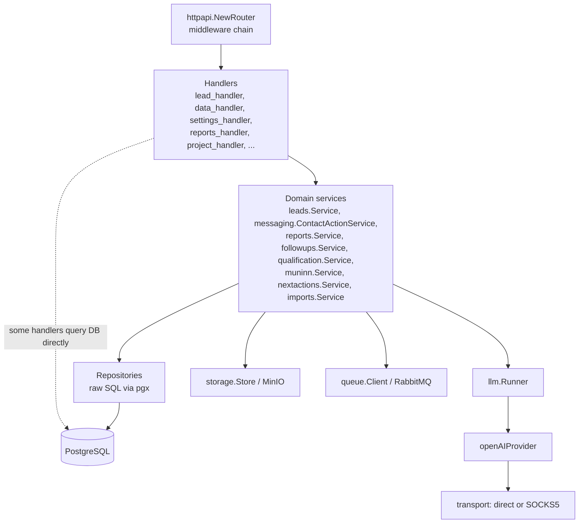
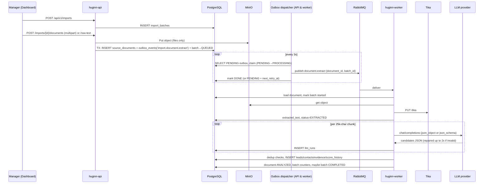
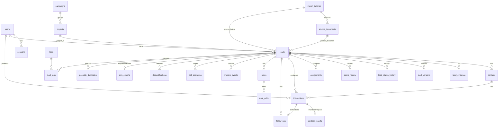
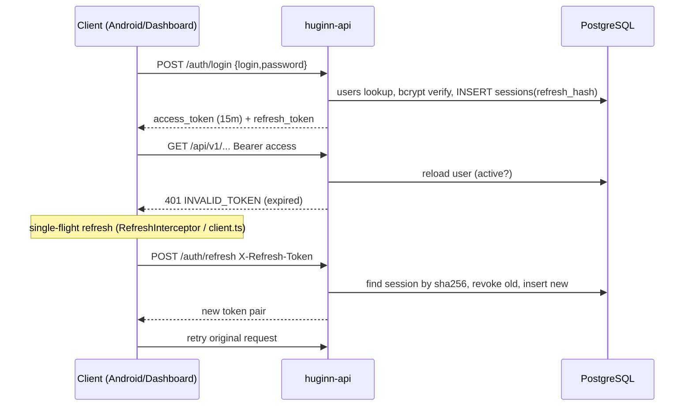
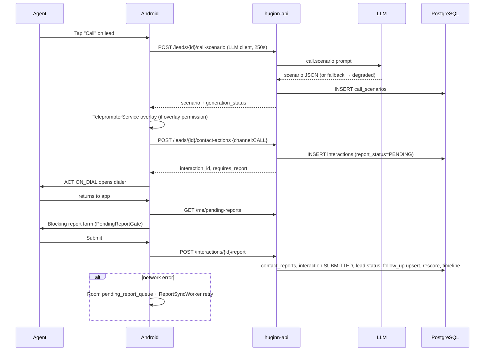

# Huginn — Technical Project Report

**Last analyzed:** 2026-10-06
**Scope:** entire repository at `/home/mtafakori/projects/Huginn` (backend, dashboard, android, root files, `graphify-out/`)
**Method:** static reading of source, migrations, configs, Dockerfiles, manifests and READMEs; cross-checked with the Graphify graph (`graphify-out/graph.json`, `GRAPH_REPORT.md`). The dashboard test suite was executed (66/66 passing). Go and Android tests were **not** executed (Go module cache not populated offline; no Android build performed). One routing behavior was reproduced with a throwaway program outside the repository (see §20).

> Conventions: "**Implemented**" = code path exists and is wired from an entry point. "**Not confirmed from the repository**" = could not be verified from code. Secret values are always redacted.

---

## 1. Executive Summary

**What it is.** Huginn is a *pre-CRM sales-intelligence and lead-qualification platform* built for **Tafakor Pardazan** (Persian-language, Iran-focused). It consists of three applications in one repository:

| App | Path | Tech | Users |
|---|---|---|---|
| Backend (API + worker + CLI) | `backend/` | Go 1.22, chi, PostgreSQL, RabbitMQ, Redis, MinIO, Apache Tika, OpenAI-compatible LLM | — |
| Admin dashboard (web) | `dashboard/` | React 18 + TypeScript + Vite, TanStack Query | `super_admin`, `sales_development_manager` |
| Field app (mobile) | `android/` | Kotlin, Jetpack Compose, Hilt, Retrofit, Room | `sales_agent` (and managers) |

**Problem it solves.** It turns raw, unstructured market data (scraped directories, PDFs, DOCX, pasted text) into deduplicated, scored, assignable sales leads; supports sales agents during first contact (AI-generated suggested messages and call scripts, deep links to dialer/SMS/WhatsApp/Telegram/Bale/Eitaa/Rubika/email); forces agents to file a structured contact report after every contact; and qualifies leads before handing them to a separate CRM called **Muninn** (not in this repo).

**Main functionality (implemented).**
- Import batches → document upload to MinIO → asynchronous Tika text extraction → LLM structured lead extraction → normalization, deduplication (exact + `pg_trgm` fuzzy) and deterministic scoring.
- Lead management with a strict state machine, versioning/history, contacts, notes, tags, evidence, timeline, audit log.
- Assignment (manual, bulk round-robin), projects and campaigns as business context.
- Contact actions (prepared, never auto-sent), LLM-generated suggested messages and **call scenarios** (with explicit `generated`/`degraded` provenance), Android teleprompter overlay.
- Mandatory contact reports, follow-ups lifecycle, "Next Best Action" work queue.
- Manager dashboard KPIs, RBAC, JWT auth with rotating refresh tokens.

**Current implementation status.** The system is a substantial, working modular monolith (~33k lines Go incl. tests, ~14k lines Kotlin main code, a full React dashboard). Several features are **partially wired**: Muninn export is queued but never dispatched to the worker (§19/§20), backend enforcement of `MANDATORY_REPORT_PENDING` does not exist (only client-side gating), several dashboard settings are stored but not consumed, a migration references a table that no migration creates, and the analytics `/reports/*` sub-routes are shadowed by another route. There is no CI configuration and no Kubernetes/production deployment manifests.

---

## 2. Project Purpose

Huginn's purpose (from `backend/README.md`, confirmed by code) is to cover the sales funnel **before** CRM:

```
Raw market information → leads → first contact → mandatory report → follow-ups → qualification → (export to Muninn CRM)
```

**Primary use cases**

| Use case | Actor | Client | Implementation |
|---|---|---|---|
| Upload raw sources (files or pasted text) and let AI extract companies/contacts | Manager / admin | Dashboard `/imports/new` | `backend/internal/imports`, `documents`, `llm`, worker |
| Review documents, candidates, duplicates; merge | Manager | Dashboard `/documents`, `/duplicates` | `internal/duplicates`, `httpapi/data_handler.go` |
| Assign leads to agents (manual / round-robin) | Manager | Dashboard `/assignments`; Android (assign) | `leads.Service.AssignRoundRobin`, `/leads/{id}/assign(-bulk)` |
| See today's work ("next best action") | Agent | Android Home / Work queue; Dashboard `/work-queue` | `internal/nextactions` |
| Contact a lead (call/SMS/messenger/email) with AI-prepared text | Agent | Android lead detail | `messaging.ContactActionService.Prepare` |
| Get an AI call script before calling, shown as floating overlay | Agent | Android | `/leads/{id}/call-scenario`, `TeleprompterService` |
| File the mandatory report after contact (offline-tolerant) | Agent | Android (blocking gate) | `/interactions/{id}/report`, `PendingReportGate`, Room queue |
| Manage follow-ups | Agent/Manager | Both | `internal/followups` |
| Qualify / disqualify; export qualified lead to Muninn | Manager | Dashboard `/leads/qualified` | `internal/qualification`, `internal/muninn` |
| Monitor KPIs, reports, audit | Manager/Admin | Dashboard | `internal/dashboard`, `internal/audit` |

**Core workflow from the agent's perspective (Android):** log in → Home shows next task → open lead → tap **Call** → app requests a call scenario (optional teleprompter overlay) and records a contact action → system dialer opens → on return the app checks `GET /me/pending-reports` and shows a blocking report form → report submitted (or queued offline) → backend updates lead status, schedules follow-up, rescores the lead.

---

## 3. Architecture Overview

**Style:** modular monolith (Go) with two runnable binaries sharing domain packages (`huginn-api`, `huginn-worker`) plus a CLI (`huginn-cli`). Two thick clients talk only to the REST API.

| Layer | Component | Evidence |
|---|---|---|
| Applications | `huginn-api` (`backend/cmd/api`), `huginn-worker` (`backend/cmd/worker`), `huginn-cli` (`backend/cmd/cli`), debug tool `backend/cmd/dbg` | `cmd/*/main.go` |
| Frontend | React SPA served by nginx (Docker) or Vite dev server | `dashboard/` |
| Mobile | Android app `ir.tafakoritech.huginn` | `android/app` |
| API | REST/JSON under `/api/v1`, plus `/health`, `/ready`, `/metrics` | `backend/internal/httpapi/router.go` |
| Database | PostgreSQL 16 (source of truth), `pg_trgm` extension | `docker-compose.yml`, `migrations/` |
| Cache | Redis 7: rate limiting, notification read-marker, readiness check | `internal/cache`, `httpapi/middleware.go`, `system_handler.go` |
| Queue | RabbitMQ 3.13: direct exchange `huginn`, DLX `huginn.dlx` → `huginn.dead` | `internal/queue/queue.go` |
| Transactional outbox | `outbox_events` table polled every 3 s by API and worker | `internal/imports/dispatch.go` |
| Object storage | MinIO bucket `huginn-source-documents`, presigned GET URLs | `internal/storage` |
| Document extraction | Apache Tika server (`PUT /tika`) | `internal/documents/tika.go` |
| AI | OpenAI-compatible Chat Completions (default DeepSeek `deepseek-v4-flash`), optional SOCKS5 egress | `internal/llm` |
| External CRM | Muninn REST (`POST {MUNINN_BASE_URL}/api/v1/leads`) | `internal/muninn/http.go` |
| Observability | `/metrics` (hand-written Prometheus text), optional Prometheus + Grafana compose profile | `httpapi/health.go`, `docker/prometheus.yml` |
| Device integrations | Intents (dialer, SMS, mailto, messengers, contacts insert), on-device `SpeechRecognizer` (fa-IR), overlay window, notifications, WorkManager | `android/.../core/external`, `core/speech`, `feature/teleprompter`, `work/` |

```mermaid
flowchart LR
  subgraph Clients
    D[Dashboard SPA<br/>React/Vite/nginx]
    A[Android app<br/>Compose/Retrofit]
  end
  subgraph Backend["Go backend (modular monolith)"]
    API[huginn-api<br/>chi router :8080]
    W[huginn-worker<br/>RabbitMQ consumers]
    CLI[huginn-cli<br/>migrate / seed / backfill]
    OB[(outbox dispatcher<br/>goroutine in API + worker)]
  end
  PG[(PostgreSQL 16<br/>pg_trgm)]
  RD[(Redis 7)]
  MQ[[RabbitMQ<br/>huginn / huginn.dead]]
  S3[(MinIO<br/>source documents)]
  TK[Apache Tika]
  LLM[OpenAI-compatible LLM<br/>DeepSeek default]
  PX{{SOCKS5 proxy<br/>optional, LLM only}}
  MU[Muninn CRM<br/>external]
  PR[Prometheus/Grafana<br/>optional profile]

  D -- REST /api/v1 + JWT --> API
  A -- REST /api/v1 + JWT --> API
  API --> PG
  API --> RD
  API --> S3
  API -- message & call-scenario generation --> PX --> LLM
  API -- writes outbox rows --> PG
  OB -- publish document.extract --> MQ
  MQ --> W
  W --> PG
  W --> S3
  W --> TK
  W -- lead extraction --> PX
  CLI --> PG
  CLI -- backfill-contacts --> LLM
  W -. muninn.export consumer exists,<br/>but no publisher .-> MU
  PR -- scrape /metrics --> API
```

---

## 4. Repository Structure

```
Huginn/
├── backend/        Go service (own .git repo, 7 commits); API, worker, CLI, migrations, Docker
├── dashboard/      React admin SPA (+ committed node_modules/ and dist/ build output locally)
├── android/        Android Studio project (own .git repo)
├── graphify-out/   Generated knowledge graph (graph.json, GRAPH_REPORT.md, graph.html)
├── .claude/        Claude Code skill (graphify) + project instructions
├── CLAUDE.md       Agent instructions for using Graphify
├── go.mod / go.sum Stray root Go module (same module path as backend; only indirect deps; no Go code at root)
└── PROJECT_REPORT.md  (this file)
```

### backend/

| Directory | Responsibility |
|---|---|
| `cmd/api` | Composition root of the REST API: loads config, connects Postgres/Redis/MinIO/RabbitMQ, builds all services, starts HTTP server and outbox dispatcher. |
| `cmd/worker` | Composition root of the queue worker: registers handlers for `document.extract`, `batch.analyze`, `muninn.export`; also runs an outbox dispatcher. |
| `cmd/cli` | Migrations (`up`/`down`/`status`), `seed`, `backfill-contacts [limit]`. |
| `cmd/dbg` | Tiny scratch program exercising `normalize.CleanSourceText` on a hardcoded Persian sample. Debug-only. |
| `internal/httpapi` | chi router, middleware (request ID, logging, recover, CORS, security headers, rate limit), all HTTP handlers, error envelope. |
| `internal/auth`, `rbac`, `passwd`, `users` | JWT access tokens, rotating hashed refresh sessions, role→permission map, bcrypt, user CRUD/sessions. |
| `internal/imports`, `documents`, `storage` | Import batches/documents, outbox, Tika extraction, LLM extraction pipeline and contact backfill, MinIO. |
| `internal/llm` | OpenAI-compatible provider, transport (direct/SOCKS5), runner with retry + JSON repair + audit (`llm_runs`), prompts and chunking. |
| `internal/leads`, `contacts`, `normalize`, `evidence`, `leadversions`, `duplicates` | Lead model + state machine, repository, versioned updates, contact normalization (Iranian phones/emails), per-field evidence, dedup detection and merge. |
| `internal/scoring`, `qualification` | Deterministic explainable score (max 82), report-driven rescoring, qualification rule checklist, disqualification reasons. |
| `internal/messaging`, `callscenarios`, `interactions`, `reports`, `followups`, `nextactions` | Contact actions, LLM suggested messages, call scenarios (generation + persistence), deep links/vCard, interactions, mandatory reports, follow-ups, work-queue ranking. |
| `internal/projects`, `campaigns`, `assignments`, `notes`, `timeline`, `audit` | Business context, assignment history, notes with edit history, lead timeline, immutable audit log. |
| `internal/dashboard`, `analytics` | Manager/agent KPIs and analytics reports. |
| `internal/muninn` | CRM export boundary: export records, outbox enqueue, HTTP exporter, payload assembler. |
| `internal/queue`, `worker`, `cache`, `database`, `config`, `logging`, `seed` | Infrastructure adapters and wiring. |
| `internal/roles` | Role CRUD repository/service — **not imported anywhere** (dead code, §19). |
| `internal/integration` | Integration tests (`HUGINN_INTEGRATION=1`). |
| `migrations/` | 15 forward-only SQL files (`001`–`015`). |
| `api/openapi.yaml` | OpenAPI 3.0.3 spec (56 paths; router registers ~138 routes). |
| `docker/` | Multi-stage `Dockerfile`, `prometheus.yml`, `mock-llm/server.py`. |
| `bin/` | Locally built binaries (git-ignored). |
| `.env.example`, `.env` | Config template / local config (`.env` is git-ignored). |

### dashboard/

| Directory | Responsibility |
|---|---|
| `src/api` | `client.ts` (fetch wrapper, token storage, single-flight refresh), `interface.ts` (`ApiEndpoints` contract), `real.ts` (REST implementation), `index.ts` (real vs mock switch), `keys.ts` (React Query keys), `types.ts`. |
| `src/mocks/mockApi.ts` | In-memory implementation of `ApiEndpoints` enabled by `VITE_USE_MOCK_API=true`; used by tests. |
| `src/auth` | `AuthContext`, `ProtectedRoute`, `permissions.ts` (mirror of backend RBAC). |
| `src/pages` | One page per route (leads, imports, documents, duplicates, assignments, agents, reports, follow-ups, work queue, projects, campaigns, settings, audit, change history). |
| `src/components` | Layout (AppShell, Sidebar, TopBar, GlobalSearch, Notifications), UI kit, custom SVG charts, follow-up forms, Jalali date picker. |
| `src/i18n`, `src/theme`, `src/styles`, `src/utils` | fa/en dictionaries with RTL, light/dark theme tokens, formatting and Jalali calendar utils. |
| `src/test` | 21 Vitest + Testing Library test files. |
| `Dockerfile`, `nginx.conf` | Build to static files; nginx SPA fallback + `/api/` reverse proxy. |

### android/

| Directory (`app/src/main/java/ir/tafakoritech/huginn/`) | Responsibility |
|---|---|
| `core/api` | Retrofit interfaces `HuginnApi`, `LlmHuginnApi` (long-timeout client), `RefreshApi`; `ApiCaller` error-envelope mapping. |
| `core/auth` | `SessionManager`, `TokenStorage` (EncryptedSharedPreferences), `AuthInterceptor`, `RefreshInterceptor` (single-flight). |
| `core/network` | OkHttp/Retrofit DI (three clients: refresh, auth, LLM), debug request logger. |
| `core/database` | Room `HuginnDatabase` (pending report queue + three cache tables not used by app code). |
| `core/external` | All Intent launchers + messenger deep-link routing. |
| `core/speech` | `SpeechRecognizerManager`, `VoiceInputController` (voice dictation for report summary). |
| `core/*` other | design system, theme, locale, notifications, permissions, utils (Persian dates, phone formatting, RTL). |
| `data/model`, `data/repository` | DTOs mirroring backend JSON; repositories wrapping API calls into `AppResult`. |
| `feature/*` | Screens + ViewModels: app gate, auth, home, leads, lead detail/edit, messaging sheets, reports (mandatory report), follow-ups, qualification, work queue, profile, settings, splash, teleprompter. |
| `work/` | `ReportSyncWorker`, `FollowUpReminderWorker`, `WorkScheduler`. |
| `app/src/test`, `app/src/androidTest` | 32 JVM test files (211 `@Test`), 4 Compose UI test files (25 `@Test`). |
| `app/schemas` | Exported Room schema. |

---

## 5. Technology Stack

| Component | Technology | Version (detected) | Purpose | Where used |
|---|---|---|---|---|
| Backend language | Go | 1.22.2 (`go.mod`), image `golang:1.22-alpine` | Services | `backend/` |
| HTTP router | go-chi/chi | v5.1.0 | Routing/middleware | `internal/httpapi` |
| DB driver | jackc/pgx | v5.7.2 (pgxpool) | PostgreSQL access (raw SQL, no ORM) | `internal/database`, repositories |
| JWT | golang-jwt/jwt | v5.2.1, HS256 | Access tokens | `internal/auth/auth.go` |
| Password hashing | golang.org/x/crypto/bcrypt | x/crypto v0.31.0 | Passwords | `internal/passwd` |
| SOCKS5 | golang.org/x/net/proxy | x/net v0.30.0 | LLM egress proxy | `internal/llm/transport.go` |
| Queue client | rabbitmq/amqp091-go | v1.10.0 | Jobs | `internal/queue` |
| Redis client | redis/go-redis | v9.7.0 | Rate limit, markers | `internal/cache` |
| Object storage | minio/minio-go | v7.0.80 | Source documents | `internal/storage` |
| UUIDs | google/uuid | v1.6.0 | IDs/validation | worker, various |
| Database | PostgreSQL | `postgres:16-alpine` | Source of truth | compose |
| DB extension | pg_trgm | — | Fuzzy company-name dedup (GIN index) | `migrations/001` |
| Cache | Redis | `redis:7-alpine` (AOF on) | Rate limit / notifications read marker | compose |
| Broker | RabbitMQ | `rabbitmq:3.13-management-alpine` | Async document processing | compose |
| Object store | MinIO | `minio/minio:latest` | Uploaded documents | compose |
| Text extraction | Apache Tika | `apache/tika:latest` | PDF/DOCX/... → text | compose, `documents/tika.go` |
| LLM | Any OpenAI-compatible `/chat/completions`; default model `deepseek-v4-flash`, base `https://api.deepseek.com` (compose default) | — | Lead extraction, messages, call scenarios, backfill | `internal/llm` |
| Dev LLM mock | Python 3 `http.server` | `python:3-alpine` | Offline pipeline testing (port 9991, internal) | `docker/mock-llm/server.py` |
| Metrics | Prometheus, Grafana | `latest` (profile `observability`) | Optional monitoring | compose |
| Web framework | React | ^18.3.1 | Dashboard UI | `dashboard/` |
| Language | TypeScript | ~5.6.2 | Dashboard | |
| Build | Vite | ^6.0.5 | Dev server/build | |
| Server state | @tanstack/react-query | ^5.62.7 | Data fetching/cache | `App.tsx`, pages |
| Tables/virtualization | @tanstack/react-table / react-virtual | ^8.20.6 / ^3.11.2 | Data grids | `components/ui/DataTable.tsx` |
| Forms | react-hook-form + zod (+ resolvers) | ^7.54.2 / ^3.24.1 | Validation | forms |
| Routing | react-router-dom | ^6.28.1 | SPA routes | `router.tsx` |
| Tests (web) | Vitest, Testing Library, jsdom | ^3.0.5 | Component/integration tests | `src/test` |
| Static server | nginx | `nginx:1.27-alpine` | Serve SPA, proxy `/api/` | `dashboard/Dockerfile` |
| Mobile language | Kotlin | 2.2.10 | Android | `android/` |
| Build | AGP / Gradle | AGP 9.3.1, Gradle wrapper (README: 9.5) | Build | `gradle/libs.versions.toml` |
| SDK | compileSdk/targetSdk 37, minSdk 28 | — | | `app/build.gradle.kts` |
| UI | Jetpack Compose (BOM 2026.02.01), Material3, Navigation Compose 2.9.8 | | Screens | |
| DI | Hilt | 2.60.1 | DI incl. workers | |
| Networking | Retrofit 2.12.0, OkHttp 4.12.0, kotlinx-serialization 1.9.0 | | REST client | `core/network` |
| Persistence | Room 2.8.4, DataStore 1.2.1, security-crypto 1.1.0 | | Offline report queue, settings, encrypted tokens | |
| Background | WorkManager 2.11.2 | | Report sync, reminders | `work/` |
| Tests (Android) | JUnit 4.13.2, Robolectric 4.16.1, coroutines-test, Compose UI test | | | `src/test`, `src/androidTest` |
| Protocols | HTTP/JSON REST, AMQP 0-9-1, S3 API, SOCKS5, Android Intents (`tel:`, `smsto:`, `mailto:`, `https://wa.me`, messenger deep links), vCard | | | |
| Tooling | Make, Docker Compose, ESLint, `go vet`/staticcheck (optional), Graphify | | | |

---

## 6. Application Components

### 6.1 huginn-api
| Item | Detail |
|---|---|
| Location | `backend/cmd/api/main.go`, `backend/internal/httpapi/*` |
| Responsibility | Synchronous REST API for both clients; also generates LLM messages/call scenarios inline and dispatches the import outbox. |
| Entry point | `main()` in `cmd/api/main.go` |
| Important modules | `httpapi` (router/handlers), `auth`, `leads`, `messaging`, `reports`, `followups`, `nextactions`, `imports`, `muninn`, `dashboard`, `analytics` |
| Dependencies | PostgreSQL (fatal if unavailable), Redis/MinIO/RabbitMQ (logged as warnings and set to `nil` if unavailable), LLM provider (fatal only on invalid proxy config) |
| Inputs | HTTP requests (JSON, multipart uploads), env vars |
| Outputs | JSON responses, DB writes, MinIO objects, `outbox_events` rows, RabbitMQ `document.extract` jobs, `llm_runs` audit rows |
| APIs exposed | `/health`, `/ready`, `/metrics`, `/api/v1/**` (§10) |
| APIs consumed | LLM `/chat/completions`, MinIO, Redis, RabbitMQ |
| Server timeouts | ReadHeader 10 s, Read 30 s, Write 240 s; graceful shutdown 10 s |

### 6.2 huginn-worker
| Item | Detail |
|---|---|
| Location | `backend/cmd/worker/main.go`, `backend/internal/worker/worker.go`, `internal/queue` |
| Responsibility | Consume RabbitMQ jobs: extract document text (Tika), run LLM extraction, update batch progress, process Muninn exports. Runs the outbox dispatcher as well. |
| Handlers | `document.extract` → `handleDocumentExtract`; `batch.analyze` → `handleBatchAnalyze` (re-publishes `document.extract` for a batch's documents — but no code publishes `batch.analyze`); `muninn.export` → `ProcessExport` (no publisher either, §20) |
| Concurrency | 4 consumer channels per job type; 1 for `muninn.export`; 5-minute per-job timeout |
| Dependencies | PostgreSQL, RabbitMQ (fatal), MinIO (warn), Tika, LLM |
| Note | No Redis usage; an `audit.Logger` is constructed and discarded (`_ = auditLogger`). |

### 6.3 huginn-cli
`backend/cmd/cli/main.go`. Commands: `up`, `down`, `status` (custom migrator in `internal/database/migrate.go`, reads `MIGRATIONS_DIR`), `seed` (`internal/seed`: admin/manager/agents + sample data), `backfill-contacts [limit=500]` (`internal/imports/backfill.go`: LLM re-extraction filling only empty contact fields).

### 6.4 Dashboard SPA
| Item | Detail |
|---|---|
| Location | `dashboard/` |
| Entry | `src/main.tsx` → `App.tsx` (QueryClient, Theme, I18n, Toast, RouterProvider) |
| Consumes | Backend `/api/v1/**` via `src/api/real.ts`, or `src/mocks/mockApi.ts` |
| Exposes | Static SPA (Vite dev :5173 or nginx :80 in container) |
| Communication | `fetch` with `Authorization: Bearer`, `X-Refresh-Token` on refresh; nginx proxies `/api/` to `BACKEND_UPSTREAM` (default `http://backend:8080`) |

### 6.5 Android app
| Item | Detail |
|---|---|
| Location | `android/app` |
| Entry | `HuginnApplication` (Hilt, WorkManager config) → `MainActivity` (single activity, Compose) → `feature/app/HuginnApp.kt` |
| Consumes | Backend `/api/v1/**` (§9), device apps through Intents, platform SpeechRecognizer |
| Exposes | Deep links `huginn://lead/*`, `huginn://report/*`, `huginn://followup/*`; non-exported `TeleprompterService` |
| Communication | Retrofit + OkHttp; base URL from Gradle property `HUGINN_API_BASE_URL` |

### 6.6 Infrastructure services (Docker Compose)
Postgres, Redis, RabbitMQ, MinIO, Tika, mock-llm, Prometheus/Grafana (profile) — see §14.

---

## 7. Backend Architecture

### 7.1 Layering



- Composition is manual (constructors in `cmd/api/main.go`); handlers receive a `httpapi.Services` struct.
- Several handlers bypass services and run SQL directly (e.g. `system_handler.go`, `agents_handler.go`, `settings_handler.go`, parts of `data_handler.go`).
- Some packages self-heal schema at startup via `EnsureSchema` (`leads`, `imports`, `projects`, `campaigns`, `callscenarios`) and `app_settings` is created lazily (`settings_handler.go: ensureSettingsTable`) — schema is therefore defined in **two** places (migrations + Go).

### 7.2 Middleware chain (`router.go`, `middleware.go`)
`RequestID` → `Logging` → `Recover` → `CORS` (allow-list from `CORS_ALLOWED_ORIGINS`, credentials allowed; headers include `X-Refresh-Token`) → `SecurityHeaders` (`nosniff`, `DENY`, `no-referrer`). Under `/api/v1`: Redis fixed-window rate limit per client IP (`RATE_LIMIT_PER_MIN`, default 300; disabled if Redis is down). Authenticated group: `AuthMW.Authenticate` (Bearer JWT + DB lookup of active user) and per-route `RequirePermission(...)`.

### 7.3 Error envelope
`internal/httpapi/response.go`: `{"error":{"code","message","details"}}` with codes such as `VALIDATION_ERROR`, `UNAUTHORIZED`, `FORBIDDEN`, `NOT_FOUND`, `CONFLICT`, `RATE_LIMITED`, `MANDATORY_REPORT_PENDING`, `DUPLICATE_EXPORT`. `internalErr()` returns a generic 500 and **does not log the error** (`auth_handler.go`).

### 7.4 Domain services (summary)

| Service | Key behavior | Tables |
|---|---|---|
| `leads` | State machine (`lead.go` transitions), versioned updates (`leadversions`), round-robin assignment, work queue (legacy) | `leads`, `lead_versions`, `lead_status_history`, `assignments`, `tags`, `lead_tags` |
| `imports` | Batch CRUD, upload (size check `MAX_UPLOAD_BYTES`) → MinIO, `CreateDocumentWithTrigger` (document + outbox row in one tx), batch progress | `import_batches`, `source_documents`, `outbox_events` |
| `documents` | Tika extraction → `EXTRACTED` → LLM analyze → `ANALYZED`; counters | `source_documents`, `import_batches` |
| `imports.ExtractionService` | Chunk text (25,000 chars, 600 overlap) → LLM per chunk → merge → normalize phones/emails → dedup (exact contact values, website, `pg_trgm` similarity ≥ 0.7) → create lead + contacts + evidence → initial score | `leads`, `contacts`, `lead_evidence`, `score_history`, `possible_duplicates` |
| `duplicates` | Detection, `possible_duplicates`, merge | `possible_duplicates` |
| `scoring` | `Score()` 7 components (25/15/10/14/8/6/4 → max 82; comment "sum 100" is stale, test asserts 82); `LeadScorer.OnReportSubmitted` promotes report facts and rescores from all reports | `score_history`, `leads.score` |
| `qualification` | Checklist: business relevant, valid contact, meaningful contact, need/interest, decision maker, next action, score ≥ `QUALIFICATION_SCORE_THRESHOLD` (70) | `disqualifications`, `leads` |
| `messaging` | `Prepare` contact action (LLM message for non-call channels with deterministic fallback, deep link, interaction row `report_status=PENDING`); call-scenario generation + persistence; vCard; sender-perspective guardrails; prompt settings from `app_settings.messaging_prompts` | `interactions`, `call_scenarios`, `app_settings` |
| `reports` | Validate + submit report (only the interaction owner unless manager override), void by manager | `contact_reports`, `interactions.report_status` |
| `followups` | Lifecycle `PENDING/SNOOZED/COMPLETED/CANCELLED`, overdue computed on read, upsert per interaction | `follow_ups` |
| `nextactions` | Builds ranked queue from pending reports (base 60), follow-ups (urgency + lead quality + commitment), inferred first-contact / stale-lead actions; never uses LLM | reads `interactions`, `follow_ups`, `leads` |
| `muninn` | Export idempotency (`crm_exports` unique per lead), enqueue outbox `muninn.export`, HTTP exporter, assembler | `crm_exports`, `outbox_events` |
| `dashboard`, `analytics` | KPI and report aggregates | read-only |
| `audit`, `timeline`, `notes` | Append-only audit; timeline events; notes with edit history | `audit_log`, `timeline_events`, `notes`, `note_edits` |

### 7.5 Authentication/authorization
See §12. Roles: `super_admin`, `sales_development_manager`, `sales_agent`, `viewer` (`internal/rbac/rbac.go`). Authorization is **role-based only**; there is no per-lead ownership check in lead handlers (§12, §20).

### 7.6 Import pipeline sequence



Error policy (`worker.go`, `queue.go`): invalid payload / unknown document / provider 4xx → permanent → dead-letter `huginn.dead`; other errors → republish with exponential backoff (`RABBITMQ_JOB_RETRY_DELAY_MS` × 2^n, capped 1 min) up to `RABBITMQ_JOB_RETRY_LIMIT` (5), then dead-letter.

---

## 8. Frontend / Web Application

| Aspect | Implementation |
|---|---|
| Framework | React 18 + TypeScript, Vite 6, path alias `@` → `src` |
| Structure | `router.tsx` defines routes inside `AppShell` behind `ProtectedRoute`; pages under `src/pages` |
| State | Server state in TanStack Query (`retry: 1`, `staleTime: 30s`, no refetch on focus); auth in React context; table filters in URL query string; theme/locale in `localStorage` |
| API layer | `src/api/index.ts` exports `api` = `realApi` or `mockApi` depending on `VITE_USE_MOCK_API`; both implement `ApiEndpoints` (`interface.ts`) |
| HTTP client | `src/api/client.ts`: Bearer injection, single-flight 401 → `POST /auth/refresh` with `X-Refresh-Token`, logout on failure, network error detection |
| Auth | Login → access + refresh token and user stored in **`localStorage`** (`client.ts`, `AuthContext.tsx`); UI permission gating via `auth/permissions.ts` (mirror of backend map) |
| i18n/RTL | Persian default (`fa`, RTL) and English; Persian digits for metrics; Jalali date picker (`utils/jalali.ts`) |
| Charts | Custom SVG (`components/charts/index.tsx`) |

**Routes** (`router.tsx`): `/login`, `/dashboard`, `/imports`, `/imports/new`, `/imports/:id`, `/documents`, `/documents/:id`, `/leads`, `/leads/qualified`, `/leads/:id`, `/duplicates`, `/assignments`, `/agents`, `/agents/:id`, `/reports`, `/reports/:id`, `/followups`, `/work-queue`, `/projects`, `/projects/:id`, `/campaigns`, `/campaigns/:id`, `/settings/{users,scoring,qualification,llm,muninn,system}`, `/audit`, `/change-history`, `*`.

**Important workflows:** create import and upload files/paste text; monitor batch progress; review document candidates and duplicates (resolve/merge); filter/assign leads; lead profile tabs (contacts, evidence, score, timeline, interactions, reports, follow-ups, notes, versions); qualify/disqualify/export to Muninn; review and override mandatory reports; manage users/sessions; edit settings.

**Dashboard calls with no matching backend route** (verified against `router.go`):

| Call in `src/api/real.ts` | Status |
|---|---|
| `GET /dashboard/lead-trend/raw` | Not registered |
| `GET /projects/{id}/leads` | Not registered (also listed in OpenAPI) |
| `POST /projects/{id}/leads` (bulk attach, used by `ProjectDetailPage.tsx`) | Not registered |
| `PATCH /projects/{id}/leads/{leadId}` | Not registered |
| `GET /health` with `root: true` | Uses `new URL(config.apiBaseUrl).origin`; with the Docker build value `/api/v1` this is a relative URL (would throw), and nginx only proxies `/api/` |

The dashboard is **not** part of `backend/docker-compose.yml`.

---

## 9. Android / Mobile Application

| Item | Value |
|---|---|
| Package / applicationId | `ir.tafakoritech.huginn` (`.debug`, `.staging` suffixes) |
| SDK | min 28, target/compile 37, JVM 11 bytecode |
| Architecture | Compose UI → ViewModel (StateFlow) → Repository (`AppResult`) → Retrofit; Hilt DI; single activity |
| Build types | `debug` (cleartext allowed), `staging` (no minify), `release` (R8; unsigned unless configured) |
| Base URL | `buildConfigField HUGINN_API_BASE_URL` from Gradle property; **default in code is `http://192.168.1.200:8080/`** (README says `http://10.0.2.2:8080/`) |

**Main screens** (`feature/app/HuginnApp.kt`, `core/navigation/Routes.kt`): Splash, Login, bottom-nav Home / Leads / Follow-ups / Reports / Profile, Lead detail, Edit lead, Settings, Qualify, Disqualify, Work queue; mandatory report is a blocking overlay driven by `PendingReportGate` (a `mandatory-report/{interactionId}` route constant exists without a `composable`).

**Important classes:** `AppGateViewModel`, `PendingReportGate`, `LeadDetailViewModel` (central; graph betweenness bridge), `MandatoryReportViewModel`, `HuginnApi`, `ApiCaller`, `SessionManager`, `RefreshInterceptor`, `ReportRepository`, `ExternalLaunchers`, `MessengerRouting`, `TeleprompterManager`/`TeleprompterService`, `SpeechRecognizerManager`.

**Services / background**
- `TeleprompterService` (non-exported): floating overlay (`TYPE_APPLICATION_OVERLAY`) showing the call scenario during a call; started from lead detail when `Settings.canDrawOverlays` is granted.
- `ReportSyncWorker`: one-time unique work (exponential backoff 30 s) enqueued when a report submission fails with a network error; posts queued reports from Room; drops 4xx (except 429); stops on 401.
- `FollowUpReminderWorker`: periodic every 2 h (scheduled from `AppGateViewModel`).

**Permissions (manifest):** `INTERNET`, `POST_NOTIFICATIONS`, `RECORD_AUDIO`, **`SYSTEM_ALERT_WINDOW`** (used by the teleprompter; not mentioned in the README's "three permissions" inventory). `<queries>` for WhatsApp, Telegram, Bale, Eitaa, Rubika packages and DIAL/SENDTO/VIEW intents. `allowBackup=false`. No contacts/SMS/call-log permissions.

**Networking:** three OkHttp clients (`NetworkModule.kt`): refresh (15/20/20 s), auth (15/30/30 s), LLM (`readTimeout 200 s`, `callTimeout 250 s`) used only by `LlmHuginnApi.callScenario`. Release/staging network config is HTTPS-only; debug permits cleartext everywhere.

**Device integrations:** no Bluetooth code found. Audio: on-device speech recognition for dictation (`fa-IR`/`en-US`), not call recording. Calls via `ACTION_DIAL`; SMS via `smsto:`; email via `mailto:`; contacts saved via `ACTION_INSERT`.

**Backend endpoints used** (from Retrofit annotations — all exist in the backend router): auth (login/refresh/logout), `/me`, `/me/work-queue`, `/me/next-actions` (+snooze/complete), `/me/pending-reports`, `/me/reports`, `/dashboard/me`, `/agents`, `/leads` (list/get/patch/assign), lead sub-resources (timeline, notes, evidence, score, interactions, followups, contacts patch), `/leads/{id}/contact-actions`, `/leads/{id}/call-scenario`, `/leads/{id}/call-scenarios` CRUD, `/interactions/{id}/report`, `/followups` CRUD/complete/reopen/reschedule, qualify/disqualify.

**Local persistence:** Room `pending_report_queue` (used), `cached_leads`, `cached_work_queue`, `cached_lead_details` (DAOs exist but are referenced only inside `core/database` — unused); DataStore (theme/language/notifications); EncryptedSharedPreferences (tokens, cached user).

---

## 10. API Documentation

Base: `http://<host>:8080`. All `/api/v1` routes except `/auth/*` require `Authorization: Bearer <access>`. "Perm" = required permission (otherwise any authenticated user).

### 10.1 Concise table

| Method | Path | Perm | Purpose |
|---|---|---|---|
| GET | `/health` | none | Liveness (always `ok`) |
| GET | `/ready` | none | Postgres + Redis ping |
| GET | `/metrics` | none | Goroutines, memory, uptime (if `METRICS_ENABLED`) |
| POST | `/api/v1/auth/login` | none | Login by username/email/mobile |
| POST | `/api/v1/auth/refresh` | none | Rotate refresh token (`X-Refresh-Token` header or `refresh_token` query) |
| POST | `/api/v1/auth/logout` | none | Revoke refresh session |
| GET | `/me`, `/me/pending-reports`, `/me/reports` | auth | Current user, pending reports, my submitted reports |
| GET | `/me/next-actions`, `/me/work-queue` | auth | Ranked work queue (same handler) |
| POST | `/me/next-actions/{actionID}/snooze`, `/complete` | auth | Act on queue item |
| GET | `/team/next-actions` | dashboard.view | Team queue |
| POST/GET | `/users`, `/users/{id}` (GET/PATCH), `/deactivate`, `/reactivate`, `/reset-password`, `/sessions`, `DELETE /sessions/{sid}` | users.manage | User admin |
| POST | `/imports` | imports.create | Create batch |
| GET | `/imports`, `/imports/{batchID}` | auth | List/get batches |
| POST | `/imports/{id}/queue`, `/documents`, `/raw-text` | imports.create | Queue batch, upload file, add text |
| GET | `/documents`, `/documents/{id}`, `/documents/{id}/candidates` | auth | Documents |
| GET/POST | `/leads` | GET auth / POST leads.create | List / create |
| GET/PATCH | `/leads/{id}` | PATCH leads.edit | Detail with `permissions` + `workflow` hints / update |
| GET | `/leads/{id}/timeline, duplicates, notes, contacts, evidence, score, interactions, reports, followups, export, call-scenarios(/{sid})` | auth | Sub-resources |
| GET | `/leads/{id}/versions(/{vid})` | leads.history | Version history |
| POST | `/leads/{id}/notes`, `/followups` | auth | Add note / follow-up |
| POST/PATCH/DELETE | `/leads/{id}/contacts(/{cid})` | leads.edit | Contact CRUD |
| GET | `/leads/{id}/contacts/{cid}/vcard` | auth | vCard |
| POST | `/leads/{id}/assign`, `/assign-bulk` | leads.assign | Assign / round-robin |
| POST | `/leads/{id}/merge` | leads.merge | Merge duplicates |
| POST | `/leads/{id}/contact-actions` | leads.contact | Prepare contact action |
| POST | `/leads/{id}/call-scenario` | leads.contact | Generate call scenario (LLM) |
| POST/PUT/PATCH/DELETE | `/leads/{id}/call-scenarios(/{sid})` | leads.contact | Saved scenarios |
| POST | `/leads/{id}/qualify` / `/disqualify` | leads.qualify / leads.disqualify | Qualification |
| POST | `/leads/{id}/export/muninn` | leads.export | Queue export (202) |
| POST/DELETE | `/leads/{id}/tags`, POST `/archive` | leads.edit | Tags, archive |
| POST | `/interactions/{id}/report`, `/open` | auth | Submit report / mark opened |
| POST | `/interactions/{id}/void` | reports.override | Void report |
| GET | `/dashboard/me` | dashboard.mine | Agent KPIs |
| GET | `/dashboard`, `/dashboard/{funnel,qualification-by-source,agent-performance,lead-trend,rejection-reasons,leads-by-city}` | dashboard.view | Manager KPIs |
| POST/GET/PUT/DELETE | `/projects(/{id})`, POST/DELETE `/projects/{id}/leads/{leadID}` | write: projects.manage | Projects |
| POST/GET/PUT/DELETE | `/campaigns(/{id})` | write: projects.manage | Campaigns |
| GET | `/jobs/pending`, `/notifications`; POST `/notifications/read` | auth | System |
| GET | `/reports/{overview,funnel,activity,score-distribution,objections,outcomes,interest,agents,projects,followups,decision-makers}` | auth | Analytics — **unreachable, shadowed by `/reports/{reportID}`** (§20) |
| GET | `/reports`, `/reports/{reportID}` | dashboard.view | Contact report list/detail |
| POST | `/reports/{id}/override` | reports.override | Override report |
| GET | `/duplicates`; POST `/duplicates/{pairID}/resolve` | resolve: leads.merge | Duplicate review |
| GET/POST | `/followups`; GET/PATCH/DELETE `/followups/{id}`; POST `/complete`, `/reopen`, `/reschedule` | auth | Follow-ups |
| GET | `/agents`, `/agents/{id}`, `/search` | auth | Agents, global search |
| GET | `/audit` | audit.view | Audit log |
| GET | `/change-history` | leads.history | Lead change history |
| GET/PUT/PATCH/POST | `/settings/{scoring,qualification,llm,llm/test,muninn,system,messaging}` | users.manage | Settings |

### 10.2 Important endpoints in detail

**`POST /api/v1/auth/login`** — body `{login, password, device?}` → `auth.Service.Login` (lookup by username/email/mobile, bcrypt verify, active check) → creates `sessions` row with sha256 of a random 48-byte refresh token → response `{user, access_token, refresh_token, expires_in, token_type:"Bearer"}` and sets an HttpOnly cookie `huginn_refresh` (cookie is never read back by the backend). Inactive users get the same 401 as wrong passwords.

**`POST /api/v1/auth/refresh`** — header `X-Refresh-Token` (or query `refresh_token`) → find session by hash; reject revoked/expired; revoke old session; issue new pair. Reuse of a revoked token is rejected but does not revoke other sessions.

**`POST /api/v1/imports/{batchID}/documents`** — multipart file → size check → MinIO `Put` → `CreateDocumentWithTrigger` (tx) → 201 document. Processing happens asynchronously (§7.6).

**`GET /api/v1/leads/{leadID}`** — `leadHandler.Get` → `leadDetail` returns lead + `permissions` (`can_edit`, `can_assign`, … derived from role only) + `workflow` hints for clients.

**`POST /api/v1/leads/{leadID}/contact-actions`** — body `{contact_id?, channel, objective?, project_id?}`; channel ∈ `CALL, SMS, WHATSAPP, TELEGRAM, BALE, EITAA, RUBIKA, EMAIL, OTHER`. Path: `messaging.ContactActionService.Prepare` → resolve project → choose contact → build lead context → for non-call channels LLM `message.generate` (fallback template) → `BuildDeepLink` → INSERT `interactions` (`action_status=CREATED`, `report_status=PENDING`) → 201 `{interaction_id, requires_report:true, suggested_message, suggested_subject, deep_link}`. Timeline event added. No pending-report check is performed.

**`POST /api/v1/leads/{leadID}/call-scenario`** — body `{contact_id?, project_id?, objective?, sales_angle?}` → `ContactActionService.CallScenario` → `CallScenarioGenerator.GenerateScenario` (LLM `call.scenario`, bounded by `CALL_SCENARIO_OP_TIMEOUT_SECONDS`) → on failure deterministic fallback with `generation_status:"degraded"`, `fallback_used:true`, `generation_error` → persisted in `call_scenarios` → 200.

**`POST /api/v1/interactions/{id}/report`** — body: `outcome`, reached/decision-maker flags and names, interest/need/capacity/timing, objection, summary, next action, `follow_up_at`, qualification recommendation. Path: `reports.Service.Submit` (owner-only unless manager override; rejects already submitted/voided) → interaction `SUBMITTED` → `updateStatusFromReport` (e.g. interested → `FOLLOW_UP`, otherwise `CONTACTING`) → `followups.UpsertForInteraction` if `follow_up_at` → `LeadScorer.OnReportSubmitted` (fact promotion + rescore) → timeline → 201. These steps are not in one transaction; secondary failures are ignored or logged.

**`POST /api/v1/leads/{leadID}/export/muninn`** — `muninn.Service.ExportQualifiedLead`: lead must be `QUALIFIED` and score > 0; creates `crm_exports` (unique per lead) with assembled payload and an `outbox_events('muninn.export')` row → 202. 409 `DUPLICATE_EXPORT` if already succeeded. See §13 for why the export is never actually sent.

---

## 11. Data Architecture

### 11.1 Stores
| Store | Usage |
|---|---|
| PostgreSQL | All domain data; raw SQL; `gen_random_uuid()` UUID PKs; enums for statuses |
| Redis | `ip:<addr>` rate-limit counters; `notif:read:<user>` (30-day TTL); readiness ping. Lock helpers exist (`cache.Lock/WithLock`) but are not used |
| MinIO | Uploaded source files (`MINIO_BUCKET`), object keys from `storage.NewObjectKey`; presigned GET (TTL `MINIO_PRESIGN_TTL_HOURS`) |
| Android Room | `pending_report_queue` (+ unused cache tables) |
| Browser localStorage | Dashboard tokens, user, theme, locale |

### 11.2 Tables (migrations `001`–`015` + runtime DDL)

| Group | Tables |
|---|---|
| Identity | `users` (role enum, unique username/email/mobile), `sessions` (refresh hash, device, IP, UA, expiry, revoked_at), `audit_log` |
| Ingestion | `import_batches` (status `UPLOADED→QUEUED→PROCESSING→REVIEW_REQUIRED/COMPLETED/FAILED`, counters, `project_id`), `source_documents` (object key, extracted_text, status), `outbox_events` (`PENDING/PROCESSING/DONE/DEAD`), `llm_runs` |
| Leads | `leads` (company fields, status enum, quality, score, owner, `source`, `project_id`, `current_version`, report facts from `012`), `lead_versions`, `lead_status_history`, `lead_evidence`, `contacts` (normalized mobile/phone/email, soft delete), `possible_duplicates`, `tags`, `lead_tags`, `assignments`, `score_history`, `disqualifications` |
| Contact work | `interactions` (channel, action/report status, suggested message, deep link, `project_id`), `contact_reports` (1:1 interaction), `follow_ups` (extended in `013`), `notes`, `note_edits`, `timeline_events`, `call_scenarios` (`004`, `008`, `010`, `011`) |
| Business context | `projects` (`005`/`006`, status, `campaign_id`), `campaigns` (`009`) |
| Export | `crm_exports` (unique `huginn_lead_id`, payload JSONB) |
| Settings | `app_settings` (key/value JSONB; created at runtime by `settings_handler.go`) |
| Migration bookkeeping | migrator version table (`internal/database/migrate.go`) |
| Referenced but never created | `project_leads` (index in `015`) — see §20 |
| Created only by unused code | `roles` (`internal/roles/roles.go`) |

Notable indexes: GIN trigram on `leads.company_name`; normalized contact columns; partial indexes on pending interactions/follow-ups/outbox; work-queue composite indexes (`015`).

### 11.3 ER diagram (core)



### 11.4 Migrations
Custom migrator (`internal/database/migrate.go`): applies unapplied files in version order; `down` only deletes the version marker (no SQL rollback; documented in README). Enum additions in `013` are used in `014` because PostgreSQL forbids using new enum values in the same transaction. `014` converts stored `OPEN`/`OVERDUE` follow-ups to `PENDING` (overdue becomes computed).

### 11.5 Data flow
Raw file → MinIO → Tika text (`source_documents.extracted_text`) → LLM candidates (`llm_runs` audit) → `leads/contacts/evidence` → assignment → `interactions` → `contact_reports` → `follow_ups` and `score_history` → `disqualifications` or qualification → `crm_exports` (+ outbox).

---

## 12. Authentication and Security

| Area | Implementation | Observations |
|---|---|---|
| Authentication | JWT HS256 access token (`JWT_ACCESS_TTL_MINUTES`, 15) signed with `JWT_ACCESS_SECRET`; issuer/audience set at issue | `ParseAccessToken` checks the HMAC method but **does not validate issuer/audience** |
| Refresh | Random 48-byte token; sha256 stored in `sessions`; rotated on refresh; 30-day TTL | `JWT_REFRESH_SECRET` is loaded but unused. Refresh token accepted in a **query string** (logging/referrer leakage risk). Cookie `huginn_refresh` is set with `Secure:false` and `MaxAge` = access TTL, and never read. `Refresh` passes the User-Agent as the `device` argument |
| User check | Every request reloads the user and rejects inactive users | Good |
| Passwords | bcrypt default cost (`internal/passwd`) | Seed defaults are documented in `backend/README.md` and `config.go` (dev only) — **must be overridden** |
| Authorization | Role → permission map (`internal/rbac`), `RequirePermission` per route | No object-level checks: any authenticated user (incl. `sales_agent`, who has `leads.edit`) can list/read/patch any lead and its contacts. Report submission is owner-checked |
| Secrets | Env vars (`.env`, git-ignored); LLM API key never accepted via settings API (`LLMUpdate` drops `api_key`) | Defaults in `config.go` include dev JWT secrets and MinIO credentials (`<redacted>`); compose defaults Postgres/RabbitMQ/MinIO/Grafana credentials to weak values. No startup guard prevents running production with defaults |
| CORS | Allow-list (`CORS_ALLOWED_ORIGINS`, supports `*`) with `Allow-Credentials: true` | Requests without `Origin` are always allowed (normal for non-browser clients) |
| TLS | None in backend/compose; Android release requires HTTPS; dashboard nginx listens HTTP | TLS termination expected externally — not confirmed from the repository |
| API security | Security headers, Redis rate limit | Client IP taken from first `X-Forwarded-For` value without trusted-proxy check → rate limit can be bypassed/spoofed |
| Input validation | `DecodeJSON` helper, domain validation (channels, report fields, disqualify reasons, UUID checks in worker), upload size limit | |
| LLM safety | System prompt treats documents as untrusted data, no fabrication; schema validation + repair (max 2) | Prompts/responses not persisted unless `LLM_PERSIST_PROMPTS` — that flag is loaded but **not referenced** by code |
| Sensitive data | Android tokens in EncryptedSharedPreferences, backups disabled, debug-only request logger without bodies | Dashboard stores access + refresh tokens in `localStorage` (XSS exposure) |
| Error handling | Generic 500 message | `internalErr` discards the error without logging → poor diagnosability |

---

## 13. External Integrations

| Integration | Purpose | Config | Used by | Data | Auth | Failure / retry |
|---|---|---|---|---|---|---|
| LLM provider (OpenAI-compatible; DeepSeek default) | Lead extraction, suggested messages, call scenarios, contact backfill | `LLM_BASE_URL`, `LLM_API_KEY`, `LLM_MODEL`, `LLM_STRUCTURED_OUTPUT_MODE`, `LLM_TIMEOUT_SECONDS`, `LLM_MAX_RETRIES`, `LLM_RETRY_BASE_DELAY_MS`, `LLM_SOCKS5_PROXY` | API, worker, CLI | Document text chunks / lead context → JSON | Bearer API key | Runner retries retryable errors (transport, 408/429/5xx) with backoff; JSON repair up to 2; `json_schema` → `json_object` fallback cached in `auto` mode; worker treats provider 4xx as permanent; message/scenario generation falls back to deterministic templates |
| SOCKS5 proxy (e.g. host Xray) | Egress for LLM traffic only | `LLM_SOCKS5_PROXY` (compose default `host.docker.internal:10808`) | `internal/llm/transport.go` | TCP tunnel | none | Malformed address = startup error |
| Apache Tika | Text extraction | `TIKA_BASE_URL` | worker (`documents/tika.go`) | File bytes → text (`PUT /tika`) | none | Failure marks document FAILED and returns error → queue retry |
| MinIO | Store uploads | `MINIO_*` | API, worker | Objects | access/secret key | API continues without storage if unavailable (uploads would then fail) |
| RabbitMQ | Job transport | `RABBITMQ_URL`, retry vars | API (publish via outbox), worker | JSON jobs | user/pass in URL | DLX + backoff (§17) |
| Redis | Rate limit, markers | `REDIS_*` | API | counters | optional password | Fail-open |
| Muninn CRM | Receive qualified leads | `MUNINN_BASE_URL`, `MUNINN_API_KEY`, `MUNINN_TIMEOUT_SECONDS` (`MUNINN_ENABLED` unused) | `internal/muninn/http.go` via worker | `ExportPayload` (company, contacts, qualification, notes, interactions, source, next action, score) → `POST /api/v1/leads`, expects 200/201 `{id}` | Bearer key | `crm_exports` marked FAILED with error; **in practice never invoked** because no component publishes `muninn.export` jobs (outbox dispatcher skips non-document events) |
| Android device apps | Dialer, SMS, email, WhatsApp, Telegram, Bale, Eitaa, Rubika, Contacts | `core/external`, manifest `<queries>` | Android | Prefilled drafts | — | "app not installed" message + web fallback |
| Android SpeechRecognizer | Voice dictation | `core/speech` | Android | Audio → text (platform service) | `RECORD_AUDIO` | Error categories surfaced to UI |
| Vazirmatn web font (CDN) | Typography | `dashboard/index.html` | Dashboard | — | — | System font fallback |

---

## 14. Runtime and Deployment

### 14.1 Docker Compose (`backend/docker-compose.yml`, network `huginn-net`, bridge)

| Service | Image / build | Ports (host:container) | Volume | Depends on | Health check |
|---|---|---|---|---|---|
| postgres | postgres:16-alpine | 5432:5432 | postgres_data | — | pg_isready |
| redis | redis:7-alpine (AOF) | 6379:6379 | redis_data | — | redis-cli ping |
| rabbitmq | rabbitmq:3.13-management-alpine | 5672, 15672 | rabbitmq_data | — | diagnostics ping |
| minio | minio/minio:latest | 9000, 9001 | minio_data | — | /minio/health/live |
| tika | apache/tika:latest | 9998:9998 | — | — | GET /version |
| mock-llm | python:3-alpine + `docker/mock-llm` | expose 9991 (internal) | ro bind | — | — |
| huginn-api | `docker/Dockerfile` target runtime, entrypoint `/app/huginn-api` | 8080:8080 | — | postgres, redis, rabbitmq, minio, tika (healthy) | wget /health |
| huginn-worker | same image, entrypoint `/app/huginn-worker` | — | — | postgres, rabbitmq, minio, tika (healthy) | — |
| prometheus | prom/prometheus:latest (profile) | 9090 | prometheus_data | — | — |
| grafana | grafana/grafana:latest (profile) | 3000 | grafana_data | prometheus | — |

Both app containers load `env_file: .env`, override internal hostnames, set `extra_hosts: host.docker.internal:host-gateway`, and default `LLM_SOCKS5_PROXY` to the host proxy. The mock LLM is only used if `LLM_BASE_URL` is pointed at `http://mock-llm:9991` (default is DeepSeek).

**Startup order:** infra (health-gated) → API/worker. Migrations are **not** run automatically by containers: run `make migrate-up` (host) or `huginn-cli up` (binary is in the image with `/app/migrations`, but `MIGRATIONS_DIR` must be set). The API/worker additionally run `EnsureSchema` DDL at startup.

### 14.2 Images
- Backend `docker/Dockerfile`: `golang:1.22-alpine` build (with `GOPROXY=https://goproxy.cn,direct`), static `CGO_ENABLED=0` binaries; runtime `alpine:3.20`, non-root user `huginn`, exposes 8080.
- Dashboard `Dockerfile`: `node:20-alpine` build (`VITE_*` build args, default `/api/v1`), runtime `nginx:1.27-alpine` with templated `nginx.conf` (`BACKEND_UPSTREAM` default `http://backend:8080`, which does not match the compose service name `huginn-api`; `proxy_read_timeout 120s`).

### 14.3 Local development
Backend: `docker compose up -d` → `make migrate-up` → `make seed` → `make dev` / `make worker`. Dashboard: `npm install && npm run dev` (:5173). Android: `./gradlew assembleDebug -PHUGINN_API_BASE_URL=...`.

### 14.4 Kubernetes / production
No Kubernetes manifests, Helm charts, Terraform or CI/CD pipelines exist. Production topology is **not confirmed from the repository** beyond notes (TLS behind proxy, change secrets, Android HTTPS URL).

---

## 15. End-to-End Workflows

### 15.1 Login and token refresh (both clients)



### 15.2 Contact action → mandatory report (Android)



### 15.3 Qualification and Muninn export (as implemented)

```mermaid
sequenceDiagram
  participant M as Manager (Dashboard)
  participant API as huginn-api
  participant PG as PostgreSQL
  participant OB as Outbox dispatcher
  participant W as Worker (muninn.export consumer)
  M->>API: POST /leads/{id}/qualify {checklist inputs, reason}
  API->>PG: rules check (score ≥ 70 etc.), status → QUALIFIED
  M->>API: POST /leads/{id}/export/muninn
  API->>PG: INSERT crm_exports(PENDING, payload) + outbox_events('muninn.export')
  API-->>M: 202 Accepted
  OB->>PG: SELECT pending outbox
  Note over OB: skips event_type != 'import.document.extract'
  Note over W: never receives a muninn.export job → export stays PENDING;<br/>lead never transitions to EXPORTED_TO_MUNINN
```

### 15.4 Import → leads
See §7.6.

---

## 16. AI / Machine Learning Components

| Aspect | Implementation |
|---|---|
| Provider | Single OpenAI-compatible adapter `openAIProvider` (`internal/llm/openai.go`), `POST {LLM_BASE_URL}/chat/completions` |
| Model | `LLM_MODEL` (default `deepseek-v4-flash`) |
| Structured output | `LLM_STRUCTURED_OUTPUT_MODE`: `auto` (code default; probe `json_schema`, fall back to `json_object` and cache), `json_object` (`.env.example`/compose default), `json_schema` |
| Runner | `internal/llm/runner.go`: retries, extract JSON from text, unmarshal into target, repair prompt up to 2 times, audits every run to `llm_runs` (purpose, model, prompt version, request hash, structured output, latency, tokens, status, error) |
| Purposes used | `lead.extract` (`imports/extraction.go`, `imports/backfill.go`), `message.generate` (`messaging/generator.go`), `call.scenario` (`messaging/call_scenario.go`). Declared but unused: `lead.dedupe`, `lead.tag`, `batch.analyze`, `repair`, `classification` |
| Prompts | `llm/prompts.go` (`ExtractionSystemPrompt`, `ExtractionJSONSchema`, prompt version `huginn-extract-v2`); `messaging/settings.go` default message prompt (v3) and call-scenario prompt (v4), overridable through `PATCH /settings/messaging` (stored in `app_settings.messaging_prompts`), sender identity from `MESSAGING_*` env |
| Guardrails | Untrusted-document instructions; no fabrication; deterministic validation/normalization of phones/emails; recovery-signal warning when source block seems to contain contacts the LLM omitted; sender-perspective checks (`messaging/perspective.go`) so messages never claim the lead's company as sender; call scenario personalization/consistency checks and explicit degraded fallback |
| Chunking | 25,000 chars, 600 overlap; candidate merge across chunks |
| Timeouts | LLM per attempt 180 s (compose) < scenario op 185 s < HTTP write 240 s < Android call 250 s |
| Speech recognition | Android platform `SpeechRecognizer` (on device / OS service) for dictation only |
| Not present | Speech synthesis, embeddings, vector database, RAG, model training/fine-tuning |
| Dev mock | `docker/mock-llm/server.py` returns fixed Persian candidates |

Input/output flow: text/lead context → prompt → provider → JSON → validation/repair → typed Go struct → DB rows (`leads`, `call_scenarios`, `interactions.suggested_message`).

---

## 17. Background Jobs and Async Processing

| Mechanism | Where | Behavior |
|---|---|---|
| RabbitMQ exchange `huginn` (direct) | `queue.go` | One durable queue per job type, bound by routing key = job type; DLX `huginn.dlx` → queue `huginn.dead` |
| Job types consumed | `worker.go` | `document.extract`, `batch.analyze`, `muninn.export` |
| Job types declared but never published/consumed | `queue.go` | `lead.extract`, `lead.dedupe`, `lead.score`, `message.generate` (README "next phase" item 1). `batch.analyze` and `muninn.export` are consumed but never published |
| Retry | `queue.handleDelivery` | Permanent → nack to DLX; transient → goroutine sleeps backoff then republishes with `retry+1` and acks original (in-memory delay; if the process stops during the sleep the original stays unacked and is redelivered) |
| Transactional outbox | `imports/dispatch.go` | Poll every 3 s (API and worker both run it); claim atomically; publish; backoff `attempts×2s` (max 5 min). `maxOutboxAttempts = 10` is declared but never referenced, so events are moved to `DEAD` only for invalid payloads, never for repeated publish failures |
| Manual batch queue | `imports.Service.QueueBatch` | `POST /imports/{id}/queue` publishes `document.extract` jobs directly, and only when the batch is still `UPLOADED`. Uploading a document already moves the batch to `QUEUED` (`CreateDocumentWithTrigger`), so this endpoint mainly matters for batches whose outbox trigger was lost |
| `batch.analyze` | `worker.go` | Consumer exists (re-publishes `document.extract` per document), but no code publishes this job type |
| Cron / scheduled backend jobs | none | Overdue follow-ups computed at read time (comment in `cmd/worker/main.go`) |
| Android WorkManager | `work/` | `ReportSyncWorker` (one-time, exponential backoff); `FollowUpReminderWorker` (periodic 2 h, KEEP) |
| CLI batch job | `backfill-contacts` | Manual LLM backfill for leads lacking contact data |

---

## 18. Configuration

### 18.1 Files
| File | Role |
|---|---|
| `backend/.env.example` | Full template (copy to `.env`) |
| `backend/.env` | Local config (git-ignored; contains real values — not reproduced here) |
| `backend/docker-compose.yml` | Container env overrides and defaults |
| `backend/internal/config/config.go` | Authoritative loader and defaults |
| `dashboard/.env.example`, `.env.development` | `VITE_*` build-time variables |
| `android/app/build.gradle.kts`, `gradle.properties`, `local.properties` | Build config; `HUGINN_API_BASE_URL` |
| `backend/docker/prometheus.yml` | Scrapes `huginn-api:8080/metrics` |

### 18.2 Backend environment variables

| Name | Purpose | Req? | Default (code) | Used by | Example |
|---|---|---|---|---|---|
| `APP_NAME`, `APP_ENV` | Name, env (logger mode) | opt | huginn, development | all | `production` |
| `HTTP_PORT` | API port | opt | 8080 | api | `8080` |
| `APP_TIMEZONE` | Displayed in system settings | opt | Asia/Tehran | api | |
| `WORKER_NAME` | Log label | opt | worker-1 | worker | |
| `POSTGRES_HOST/PORT/USER/PASSWORD/DB/SSLMODE` | DB connection | req in prod | localhost/5432/huginn/`<redacted>`/huginn/disable | all | |
| `POSTGRES_MAX_CONNS/MIN_CONNS/MAX_CONN_LIFETIME` | Pool (minutes) | opt | 20/2/30 | all | |
| `REDIS_ADDR/PASSWORD/DB` | Redis | opt | localhost:6379/""/0 | api | |
| `RABBITMQ_URL` | AMQP URL | req for worker | amqp://…@localhost:5672/ (`<redacted>`) | api, worker | |
| `RABBITMQ_USER/PASSWORD` | Compose only | opt | huginn/`<redacted>` | compose | |
| `RABBITMQ_JOB_RETRY_LIMIT`, `RABBITMQ_JOB_RETRY_DELAY_MS` | Retry policy | opt | 5, 5000 | api, worker | |
| `MINIO_ENDPOINT/ACCESS_KEY/SECRET_KEY/USE_SSL/BUCKET/PRESIGN_TTL_HOURS` | Object store | req for uploads | localhost:9000/`<redacted>`/`<redacted>`/false/huginn-source-documents/1 | api, worker | |
| `TIKA_BASE_URL` | Tika | req for files | http://localhost:9998 | worker | |
| `JWT_ACCESS_SECRET` | HMAC key | **req (prod)** | dev default `<redacted>` | api | 32+ random bytes |
| `JWT_REFRESH_SECRET` | Loaded, **unused** | — | dev default | — | |
| `JWT_ACCESS_TTL_MINUTES`, `JWT_REFRESH_TTL_DAYS` | TTLs | opt | 15, 30 | api | |
| `JWT_ISSUER`, `JWT_AUDIENCE` | Claims (not validated on parse) | opt | huginn, huginn-clients | api | |
| `REFRESH_COOKIE_NAME` | Cookie name | opt | huginn_refresh | api | |
| `LLM_BASE_URL` | Provider URL | req for AI | "" (compose: https://api.deepseek.com) | api, worker, cli | |
| `LLM_API_KEY` | Provider key | req for AI | "" | same | `<redacted>` |
| `LLM_MODEL` | Model | opt | deepseek-v4-flash | same | |
| `LLM_STRUCTURED_OUTPUT_MODE` | auto/json_object/json_schema | opt | auto (compose json_object) | same | |
| `LLM_TIMEOUT_SECONDS` | Per attempt | opt | 60 (compose/.env.example 180) | same | |
| `LLM_MAX_RETRIES`, `LLM_RETRY_BASE_DELAY_MS` | Retry | opt | 3, 500 | same | |
| `LLM_PERSIST_PROMPTS` | Loaded, **unused** | — | false | — | |
| `LLM_SOCKS5_PROXY` | host:port for LLM egress | opt | "" (compose host.docker.internal:10808) | same | `127.0.0.1:10808` |
| `CALL_SCENARIO_OP_TIMEOUT_SECONDS` | Scenario op budget | opt | 185 | api | |
| `MAX_UPLOAD_BYTES` | Upload limit | opt | 26214400 | api | |
| `QUALIFICATION_SCORE_THRESHOLD` | Min score | opt | 70 | api | |
| `MESSAGING_COMPANY_NAME/DESCRIPTION/SENDER_NAME/SENDER_TITLE` | Sender identity in AI messages | recommended | "" | api | |
| `MUNINN_ENABLED` | Loaded, **unused** | — | false | — | |
| `MUNINN_BASE_URL`, `MUNINN_API_KEY`, `MUNINN_TIMEOUT_SECONDS` | CRM | opt | "", "", 30 | worker | |
| `CORS_ALLOWED_ORIGINS` | Comma list | opt | http://localhost:3000,http://localhost:5173 | api | |
| `RATE_LIMIT_PER_MIN` | Per-IP limit | opt | 300 | api | |
| `METRICS_ENABLED` | `/metrics` toggle | opt | true | api | |
| `SEED_ADMIN/MANAGER/AGENT_PASSWORD` | Seed users | dev | defaults `<redacted>` | cli seed | |
| `MIGRATIONS_DIR` | Migration path | req for cli | — (Makefile: migrations) | cli | |
| `HUGINN_INTEGRATION` | Enable integration tests | test | — | tests | `1` |
| `GRAFANA_ADMIN_PASSWORD` | Compose | opt | `<redacted>` | grafana | |

### 18.3 Dashboard
`VITE_API_BASE_URL` (default `http://localhost:8080/api/v1`), `VITE_APP_NAME`, `VITE_DEFAULT_LOCALE` (`fa`/`en`), `VITE_DEFAULT_THEME`, `VITE_USE_MOCK_API`; nginx runtime: `BACKEND_UPSTREAM`, `DASHBOARD_PORT`.

### 18.4 Android
Gradle property `HUGINN_API_BASE_URL` (default in code `http://192.168.1.200:8080/`).

### 18.5 Runtime settings (database `app_settings`)
| Key | Written by | Consumed at runtime? |
|---|---|---|
| `messaging_prompts` | `PATCH /settings/messaging` | **Yes** (`messaging.PostgresPromptSettings`) |
| `scoring` | `PUT /settings/scoring` | No — `scoring.Score` uses hardcoded weights |
| `qualification` | `PATCH /settings/qualification` | No — threshold comes from env |
| `llm` | `PATCH /settings/llm` | No — provider built from env at startup; `POST /settings/llm/test` only checks that a model name is configured |
| `muninn` | `PATCH /settings/muninn` | No — exporter uses env |

---

## 19. Current State

### Implemented
- REST API with RBAC, JWT + rotating refresh sessions, user/session admin, audit log (`httpapi`, `auth`, `users`, `audit`).
- Import batches, file upload to MinIO, raw text input, outbox-driven async document processing, Tika extraction, chunked LLM extraction with validation/repair, normalization, deduplication (exact + trigram), evidence, initial scoring (`imports`, `documents`, `llm`, `duplicates`, `scoring`).
- Lead CRUD, strict state machine, versions/diffs, contacts, notes with edits, tags, archive, timeline, merge, round-robin assignment.
- Contact actions with LLM suggested messages + deterministic fallback, deep links, vCard; call scenario generation with explicit provenance and persistence; saved scenario CRUD.
- Mandatory report submission/void/override; report-driven status changes, follow-up creation and rescoring.
- Follow-up lifecycle; Next Best Action queue (agent and team).
- Projects and campaigns.
- Manager/agent dashboards; notifications summary; global search.
- Messaging prompt settings editable at runtime.
- Dashboard SPA covering all of the above with fa/en, RTL, dark/light, mock mode, 66 passing tests.
- Android app: login, home/work queue, leads, lead detail/edit, contact sheets and Intent launchers, call scenario + teleprompter overlay, blocking mandatory report with voice dictation and offline queue, follow-ups, qualify/disqualify, settings, reminders.
- Dev tooling: Makefile, compose stack, seed, migrations, mock LLM, optional Prometheus/Grafana.

### Partially Implemented
- **Muninn export:** export record + outbox event are created and the worker has a consumer, but nothing publishes `muninn.export` jobs; lead status is never set to `EXPORTED_TO_MUNINN`; `MUNINN_ENABLED` is ignored.
- **Mandatory report enforcement:** backend defines `ErrMandatoryReportPending`/`MANDATORY_REPORT_PENDING` and handles it in `ContactAction`, but `Prepare` never returns it; enforcement exists only in the Android client gate.
- **Analytics reports** (`internal/analytics` + `reports_handler.go`): implemented but unreachable over HTTP due to route shadowing; neither client calls them.
- **Settings pages** for scoring/qualification/LLM/Muninn: persist values that the runtime ignores; LLM "test" does not contact the provider.
- **Project ↔ lead management in dashboard:** list/bulk-attach/update calls target routes that do not exist.
- **Metrics:** only three runtime gauges; no request/queue/LLM metrics.
- **OpenAPI spec:** 56 paths vs ~138 registered routes; contains paths not implemented (`GET /projects/{id}/leads`).
- **Android cache tables** (`cached_leads`, etc.) defined but unused.

### Planned / Referenced
- Async `lead.score`, `lead.dedupe`, `message.generate` jobs (README "next phase"; constants in `queue.go`).
- Pagination for timeline/notes/interactions; configurable report-blocking; PDF page metadata from Tika; CI with GitHub Actions (backend README).
- Configurable work-queue weights (README known limitations).
- Android: tablet two-pane layout, import/document screens, default-dialer mode, server push notifications (android README).
- LLM purposes `lead.tag`, `classification`, `batch.analyze` (declared only).

### Deprecated / Legacy
- `internal/roles` package (353 lines, creates a `roles` table) — not imported by any binary.
- `cmd/dbg` — ad-hoc debug program.
- `leads.Repository.WorkQueue` (used by `/dashboard/me` agent KPI) still filters follow-ups by `status='OPEN'`, superseded by `nextactions` and by migration `014`.
- Follow-up status `OPEN`/`OVERDUE` queries remaining in `system_handler.go`, `agents_handler.go`, `dashboard/analytics.go`.
- Root `go.mod`/`go.sum` (no root Go code).
- Unused config: `JWT_REFRESH_SECRET`, `LLM_PERSIST_PROMPTS`, `MUNINN_ENABLED`; refresh cookie that is never read.

---

## 20. Known Problems and Technical Risks

All items are evidence-based; file references given.

| # | Category | Issue | Evidence |
|---|---|---|---|
| 1 | Broken feature | **Muninn exports never leave Huginn.** `DispatchOutbox` ignores events whose type is not `import.document.extract`; no code publishes `queue.JobMuninnExport`. Exports stay `PENDING`. | `internal/imports/dispatch.go`, `internal/muninn/muninn.go:366`, `internal/worker/worker.go` |
| 2 | Routing bug | `r.Get("/reports/{reportID}")` on the parent router shadows every static child of the mounted `/reports` sub-router; `GET /api/v1/reports/overview` etc. are dispatched to `dataH.ReportGet`. Reproduced with chi v5.1.0 in a throwaway program. | `internal/httpapi/router.go` (`/reports` Route vs `/reports/{reportID}`) |
| 3 | Migration | `015_next_actions_indexes.sql` creates an index on `project_leads`, a table no migration or code creates → `migrate-up` on a fresh database fails at 015 (unless the table already exists from outside the repo). | `migrations/015…sql:11`; `git log -S project_leads` shows only that index and OpenAPI text |
| 4 | Business rule gap | Mandatory report is not enforced by the backend despite README claims; any client (dashboard, scripts) can create unlimited contact actions with pending reports. | `messaging/actions.go` (`Prepare`), `ErrMandatoryReportPending` never returned |
| 5 | Stale queries | After `014`, follow-ups are never `OPEN`/`OVERDUE`, but several queries still use those values → counts always 0 (notifications, agent overdue KPI, agent work queue). | `system_handler.go:111`, `agents_handler.go:58`, `dashboard/analytics.go:114`, `leads/repository.go:488` |
| 6 | Security | No object-level authorization on leads: agents can read/patch any lead and its contacts. | `lead_handler.go` (List/Get/Update), `rbac.go` (`sales_agent` has `leads.edit`) |
| 7 | Security | Rate limiter trusts `X-Forwarded-For` blindly → spoofable/bypassable. | `middleware.go: clientIP` |
| 8 | Security | JWT issuer/audience not validated; refresh token accepted via query string; refresh cookie `Secure:false` with wrong `MaxAge` and never used; dashboard stores tokens in `localStorage`. | `auth/auth.go`, `auth_handler.go`, `dashboard/src/api/client.ts` |
| 9 | Security / ops | Insecure defaults (JWT secrets, MinIO, Postgres, RabbitMQ, Grafana, seed passwords) with no production guard. | `config.go`, `docker-compose.yml` |
| 10 | Observability | `internalErr` drops the error without logging; many `_ =` ignored errors in multi-step handlers (report submission, timeline, audit). | `auth_handler.go:100`, `lead_handler.go` |
| 11 | Consistency | Report submission side effects (status, follow-up, rescore, timeline) are not transactional. | `lead_handler.go: SubmitReport` |
| 12 | Contract drift | Dashboard calls 4 nonexistent routes (§8); OpenAPI lists unimplemented `GET /projects/{id}/leads` and omits ~80 routes; README endpoint list in dashboard is outdated. | `dashboard/src/api/real.ts`, `api/openapi.yaml` |
| 13 | Config drift | Settings for scoring/qualification/LLM/Muninn are stored but ignored; unused env vars (`JWT_REFRESH_SECRET`, `LLM_PERSIST_PROMPTS`, `MUNINN_ENABLED`). | `settings_handler.go`, `config.go` |
| 14 | Schema duplication | Schema defined both in migrations and `EnsureSchema`/lazy DDL in Go; risk of divergence. | `leads/repository.go:540`, `projects/repository.go:205`, `campaigns/repository.go:189`, `callscenarios/scenarios.go:355`, `settings_handler.go:16` |
| 15 | Queue robustness | Retry delay implemented by sleeping goroutines holding unacked deliveries; outbox events are never marked `DEAD` after repeated publish failures (`maxOutboxAttempts` defined but unused in dispatch). | `queue.go:285`, `dispatch.go` |
| 16 | Deployment | Dashboard not in compose; nginx default upstream `backend:8080` ≠ `huginn-api`; nginx `proxy_read_timeout 120s` below the API's 240 s write timeout; root health URL logic breaks with relative `VITE_API_BASE_URL`. | `dashboard/nginx.conf`, `Dockerfile`, `client.ts:113` |
| 17 | Docs drift (Android) | Manifest declares `SYSTEM_ALERT_WINDOW` (teleprompter) though README lists three permissions; default base URL is a hardcoded LAN IP `192.168.1.200` while README claims `10.0.2.2` and "no developer IP hardcoded"; Room is documented as queue-only but defines 3 unused cache tables. | `AndroidManifest.xml`, `app/build.gradle.kts`, `HuginnDatabase.kt` |
| 18 | Stale comment | Scoring comment says weights "sum 100"; actual max is 82 (test confirms), threshold 70. | `scoring/scoring.go:39`, `scoring_test.go:38` |
| 19 | Dead code | `internal/roles`, `cmd/dbg`, unused queue job types and LLM purposes, unused cache helpers. | §19 |
| 20 | Build/process | No CI; Go tests not runnable offline in this environment; Android lint `abortOnError=false`; release unsigned; `:latest` image tags for MinIO/Tika/Prometheus/Grafana; backend Dockerfile hardcodes `GOPROXY=https://goproxy.cn`. | repo tree, `build.gradle.kts`, compose, Dockerfile |
| 21 | Scalability | LLM calls for messages/call scenarios run synchronously inside HTTP requests (up to 240 s); outbox polling every 3 s by every API and worker instance; per-request user DB lookup. | `cmd/api/main.go`, `dispatch.go`, `auth/middleware.go` |
| 22 | Repo hygiene | Backend and Android are separate git repositories nested in an untracked parent; `dashboard/dist` and `node_modules` present locally; `.env` present locally (git-ignored). | `backend/.git`, `android/.git` |

No `TODO`/`FIXME` markers exist in source except one Android template comment (`res/xml/data_extraction_rules.xml`).

---

## 21. Testing

| Suite | Location | Framework | Size | How to run | Status |
|---|---|---|---|---|---|
| Go unit | `backend/internal/**/_test.go` | `testing` | 45 files, 223 `Test*` funcs | `make test` / `go test ./...` | Not executed here (modules not cached) |
| Go integration | 8 files gated by `HUGINN_INTEGRATION` (`internal/integration/*`, `followups_integration_test.go`, `reports_integration_test.go`, `nextactions/service_integration_test.go`, `scoring/lead_scorer_integration_test.go`, `callscenarios/scenarios_test.go`, `analytics/debug_test.go`, `httpapi/data_handler_test.go`) | `testing` + live services | — | `docker compose up -d` then `HUGINN_INTEGRATION=1 go test ./...` | Not executed |
| Dashboard | `dashboard/src/test` | Vitest + Testing Library + jsdom (mock API) | 21 files, 66 tests | `npm run test` | **66/66 passed** (2026-10-06) |
| Android JVM | `android/app/src/test` | JUnit4, Robolectric, coroutines-test, `MockHuginnApi` | 32 files, 211 tests | `./gradlew test` | Not executed |
| Android UI | `android/app/src/androidTest` | Compose UI test | 4 files, 25 tests | `./gradlew connectedDebugAndroidTest` | Not executed |
| E2E | — | none | — | — | No end-to-end tests across clients and backend |

Coverage reports: none in the repository.

**Important untested or weakly tested areas** (based on what exists): router-level wiring (the `/reports` shadowing and missing dashboard routes were not caught because dashboard tests use the mock API and handler tests build their own routers); Muninn export end-to-end through the outbox; migration application on a fresh database (would expose `project_leads`); object-level authorization; outbox `DEAD` handling.

---

## 22. Developer Workflow

1. **Install dependencies**
   - Go 1.22+, Docker + Compose, `make`.
   - Dashboard: Node ≥ 20, `cd dashboard && npm install`.
   - Android: Android Studio with SDK 37, JDK 17+; Gradle wrapper included.
2. **Configure environment**
   - `cd backend && cp .env.example .env`; set `LLM_BASE_URL`, `LLM_API_KEY`; change all secrets for non-dev use; set `LLM_SOCKS5_PROXY=` (empty) if no proxy is available, or point `LLM_BASE_URL` to `http://mock-llm:9991` inside compose for offline work.
   - `cd dashboard && cp .env.example .env.local`.
3. **Start the project**
   ```bash
   cd backend
   docker compose up -d          # infra + huginn-api + huginn-worker containers
   make migrate-up               # NOTE: may fail at 015 on a fresh DB (project_leads)
   make seed
   cd ../dashboard && npm run dev   # http://localhost:5173
   ```
4. **Run individual services (host)**: `make dev` (API), `make worker`, `make migrate-status`, `make backfill-contacts`, `make logs` (compose logs), optional `docker compose --profile observability up -d`.
5. **Run tests**: `make test`; `HUGINN_INTEGRATION=1 go test ./internal/integration/...`; `npm run test`; `npm run lint`; `./gradlew test`; `./gradlew lintDebug`; `./gradlew connectedDebugAndroidTest`.
6. **Build production artifacts**: `make build` (→ `bin/huginn-{api,worker,cli}`); `docker build -f docker/Dockerfile .` in `backend`; `npm run build` (→ `dashboard/dist`) or `docker build --build-arg VITE_API_BASE_URL=/api/v1 -t huginn-dashboard ./dashboard`; `./gradlew assembleRelease -PHUGINN_API_BASE_URL=https://…/` (add signing config).
7. **Debug common problems**
   - API exits at start: Postgres unreachable, or `LLM_SOCKS5_PROXY` malformed.
   - LLM calls fail in Docker: compose defaults `LLM_SOCKS5_PROXY` to `host.docker.internal:10808`; clear it if no proxy runs; DeepSeek needs `LLM_STRUCTURED_OUTPUT_MODE=json_object`.
   - Uploads stuck in `QUEUED`: RabbitMQ unavailable at API start (`q == nil` disables the API dispatcher) — the worker's dispatcher still publishes; check `outbox_events` and the `huginn.dead` queue (management UI :15672).
   - Rate limiting/notifications behave oddly: Redis down → fail-open.
   - Android cannot reach backend: pass `-PHUGINN_API_BASE_URL` (default LAN IP); release builds require HTTPS.
   - Analytics `/reports/<name>` returns a report lookup error: route shadowing (§20 #2).

---

## 23. Important Code Relationships

Derived from `graphify-out/GRAPH_REPORT.md` and a degree analysis of `graph.json` (5,006 nodes, 17,377 edges, 182 communities), then checked against source.

| Area | Most connected nodes (degree) | Meaning |
|---|---|---|
| Backend | `router.go` (106), `RespondOK()` (96), `database.DB` (86), `RespondError()` (83), `imports/extraction.go` (74), `internalErr()` (72), `lead_handler.go` (62), `leads/service.go` (57), `messaging/call_scenario.go` (57), `auth.FromContext()` (52) | HTTP layer and DB handle are the hubs; extraction and call-scenario generation are the most complex domain files |
| Dashboard | `useI18n()` (122), `ApiEndpoints` (112), `api/types.ts` (103), `LeadDetailPage.tsx` (91), `mockApi.ts` (89) | Every page depends on i18n and the API contract; mock and real implementations both hang off `ApiEndpoints` |
| Android | `LeadDetailScreen.kt` (110), `huginnColors()` (103), `TeleprompterService.kt` (74), `LeadDetailViewModel` (73), `MandatoryReportScreen.kt` (71), `HuginnApi` (63) | Lead detail is the central screen; `HuginnApi` connects 11 communities |

**Bridge nodes (betweenness):** `MockHuginnApi` (0.028, test double coupled to 14 Android communities), `LeadDetailViewModel` (0.012), `HuginnApi` (0.010).

**Key cross-component relationships (verified in code):**
- `cmd/api/main.go` → constructs every service → `httpapi.Services` → `NewRouter`.
- `imports.CreateDocumentWithTrigger` → `outbox_events` → `imports.DispatchOutbox` → `queue.Publish(document.extract)` → `worker.handleDocumentExtract` → `documents.Service.ProcessDocument` → `imports.ExtractionService` → `llm.Runner` / `duplicates.Detector` / `scoring.Score`.
- `leadHandler.ContactAction` → `messaging.ContactActionService.Prepare` → `messaging.Generator` (LLM) + `BuildDeepLink` → `interactions`.
- `leadHandler.SubmitReport` → `reports.Service.Submit` → `leads.Service.ChangeStatus` + `followups.UpsertForInteraction` + `scoring.LeadScorer.OnReportSubmitted`.
- `nextactions.Service.Build` ← `/me/next-actions`, `/me/work-queue`, `/team/next-actions` ← Android Home/WorkQueue and dashboard WorkQueuePage.
- `muninn.Service.ExportQualifiedLead` → outbox `muninn.export` ⟶ *(no dispatcher)* ⟶ `worker.handleMuninnExport` → `muninn.HTTPExporter`. Graphify also finds **no path** from `DispatchOutbox()` to `handleMuninnExport()`.
- Android `RefreshInterceptor` and dashboard `client.ts` implement the same single-flight refresh against `/auth/refresh` (graph: semantically similar, cross-file).
- Data model mirroring: `backend/internal/*` structs ↔ `dashboard/src/api/types.ts` ↔ `android/.../data/model/*.kt` (no code generation; maintained by hand).

---

## 24. Project Map

```
                         ┌──────────────── Clients ────────────────┐
                         │ dashboard/ (React, managers)            │
                         │ android/   (Compose, agents)            │
                         └───────────────┬─────────────────────────┘
                                         │ REST /api/v1 (JWT)
┌──────────────────────── backend/ (Go modular monolith) ───────────────────────────┐
│ cmd/api ── httpapi (router, middleware, handlers) ──┐                             │
│                                                     ├─ domain packages:           │
│ cmd/worker ── worker + queue (RabbitMQ consumers) ──┤  leads, contacts, imports,  │
│                                                     │  documents, llm, messaging, │
│ cmd/cli ── migrate / seed / backfill ───────────────┘  reports, followups,        │
│                                                        nextactions, scoring,      │
│                                                        qualification, muninn, ... │
└──────┬──────────┬──────────┬──────────┬──────────┬──────────┬────────────────────┘
   PostgreSQL   Redis    RabbitMQ    MinIO      Tika    LLM (DeepSeek, via SOCKS5)   Muninn CRM (external)
```

**Five things to know in five minutes**
1. Everything business-critical lives in `backend/internal`; start reading at `cmd/api/main.go` and `internal/httpapi/router.go`.
2. Ingestion is asynchronous: upload → outbox row → dispatcher → RabbitMQ → worker → Tika → LLM → leads (`imports/extraction.go`).
3. Contact work is synchronous: contact action → interaction (report pending) → report → status/follow-up/score (`messaging/actions.go`, `httpapi/lead_handler.go`).
4. The LLM is used for three things only: lead extraction, suggested messages, call scenarios — all through `llm.Runner` with audit in `llm_runs`.
5. Clients mirror backend types by hand; the backend router (not OpenAPI, not READMEs) is the source of truth for the API.

---

## 25. Final Assessment

| Dimension | Assessment |
|---|---|
| Architectural maturity | **Moderate-to-good.** Clear modular monolith, sensible package boundaries, outbox + DLX patterns, explicit LLM provenance and safety prompts, strict state machine, audit trail. Weakened by incomplete wiring (Muninn, backend report enforcement), routing/migration defects and absent CI/deployment automation. |
| Maintainability | **Moderate.** Readable Go with good comments and many tests; but handlers are large (`lead_handler.go` ~1,100 lines), some handlers embed SQL, schema exists in two places, three hand-maintained copies of the API model, and documentation/spec drift is significant. |
| Complexity | **Medium-high.** ~45 backend packages, ~138 routes, 15 migrations, three LLM use cases, two clients with offline and overlay features, Persian/RTL and Jalali handling throughout. |
| Major strengths | Careful LLM integration (untrusted input, validation/repair, degraded-mode transparency, SOCKS5 isolation, timeout hierarchy); reliable ingestion design (transactional outbox, permanent vs transient failure classification); thoughtful mobile UX (blocking report gate, offline queue, privacy-preserving Intents, no sensitive permissions); strong client test suites; RTL-first UI. |
| Major weaknesses | Features that appear complete but are not end-to-end (Muninn export, backend mandatory report enforcement, settings that do nothing, shadowed analytics routes, dashboard calling missing routes); role-only authorization; insecure defaults; silent error swallowing; stale status queries after the follow-up migration. |
| Most important technical risks | (1) Fresh-database migration failure at `015`; (2) qualified leads never reaching Muninn; (3) lack of object-level authorization and spoofable rate limiting; (4) contract drift between router, OpenAPI and clients with no CI to catch it; (5) synchronous long LLM calls in the request path. |
| Understand before modifying | `internal/httpapi/router.go` (route order/shadowing, permissions), `internal/imports/{imports,dispatch,extraction}.go` + `internal/queue/queue.go` (pipeline and retry semantics), `internal/leads/lead.go` (state machine), `internal/messaging/{actions,call_scenario,settings}.go` (AI outputs and fallbacks), `internal/reports` + `lead_handler.go: SubmitReport` (report side effects), `migrations/013–015` (follow-up status model), Android `feature/app/PendingReportGate.kt` and `data/repository/ReportRepository.kt` (client-side enforcement and offline queue). |
